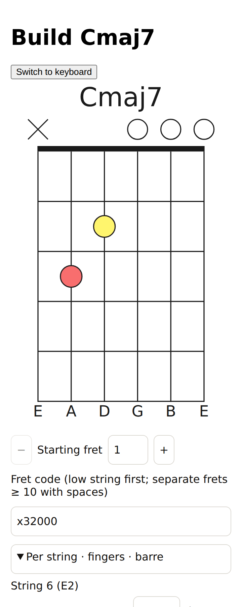
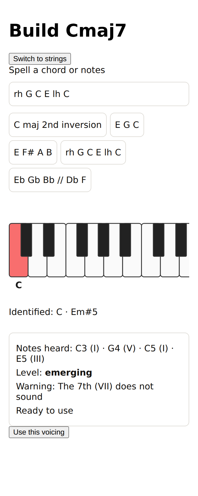

# Handoff: 0057 — Voicing editor package (codex → lead)

- **Date:** 2026-11-19
- **Type:** return
- **Ledger:** 0057 (lead owns updates)
- **Spec:** [crf-staff 0030 r2](https://github.com/pepperhorn/crf-staff/blob/main/docs/specs/0030-chord-voicings-audition-builder.md), [shared voicing format](../superpowers/specs/2026-10-29-voicing-submissions-design.md)
- **Plan:** [crf-staff 0030 t1](https://github.com/pepperhorn/crf-staff/blob/main/docs/plans/0030-chord-voicings-audition-builder.md)
- **Dispatch / receiver acknowledgement:** [lead → codex](2026-11-19-0057-voicing-editor--lead-to-codex.md), committed first as dee1345.
- **Branch:** orch/0057-voicing-editor
- **Worktree:** /home/shaun/.t3/worktrees/chordl/orch-0057-voicing-edito-c3380c80a408b95b
- **Base commit:** fea29ac (dispatch and keyboard-default amendment)
- **PR:** draft; linked in completion message and PR body
- **Port:** 5770 (demo)
- **Status:** ready for review

## Goal
Ship `@pepperhorn/chordl-voicing-editor`: KeyboardSpeller, FrettedEditor, VoicingChecks and canUse, with additive format/card conversion, computed levels and standard-first alternatives. The host owns use/save/cancel and persistence. Nothing published to npm.

## Scope
- **In:** new package, scoped CSS, README, demo, DOM tests and browser evidence; additive voicing source/tests; cards source/tests and its voicing dependency; root script chains and lockfile; own handoffs.
- **Out:** storage/submission, AI, bowed editors, editable tunings, publishing, BoardEditor changes, default requestFor selection and ledger edits.
- **Files owned:** exactly the dispatch's paths. No board files needed changes. Existing cards behavior is preserved unless the new optional custom-request fields are supplied.

## Acceptance criteria and result
- Computed levels delegate to existing keyboard, fretted and top3 rules, ignoring stored levels; comparison fixtures cover guitar, top3, ukulele, bass4 and keyboard.
- All 36 combinations of six faces × C/G/Am/F/D7/Em compare equal requests **and actual rendered SVGs** after conversion round trips.
- Standard-first alternatives are deduplicated by shapeHash, carry levels, and return multiple G guitar options. Keyboard inversions and library/generated variants reuse existing rules.
- DOM tests cover musical text examples, exact bare-note output, hand assignment, parse failure/null output, fifth omission versus wrong notes, stable draft identity, initial/basedOn, fret-code/fields, taps, fingers, barres, starting fret, top3 locks, bass and ukulele.
- Runtime dependency guard remains green with the new declared cards → voicing dependency.
- Chromium at 360 px: tapped Cmaj7 to x32000, 36 real measured targets, minimum target width 49.398 px, nut height 44 px; no page overflow. Keyboard has four correct CRF highlights and scrolls inside its 328 px container (620 px content). No captured console errors or unhandled exceptions.
- Full workspace verification: see below.

## Verify with
```bash
pnpm install --frozen-lockfile
pnpm build && pnpm lint && pnpm test:run && pnpm --filter @pepperhorn/chordl-react build:site
```

Verification output: 
```text
pnpm install --frozen-lockfile: PASS
pnpm build: PASS
pnpm lint: PASS
pnpm test:run: PASS (3,027 tests across 163 files)
  voicings 176; core 712; listen 13; guitar 337; voicing 164;
  react 397; cards 865; board 347; editor 16
pnpm --filter @pepperhorn/chordl-react build:site: PASS
  447 modules transformed; built in 5.76s
36 real SVG round trips: PASS
360px Chromium pass: PASS; captured errors []
git diff --check: PASS
```
The existing jsdom navigation diagnostics and Vite/Verovio externalization, large-chunk and API Extractor compiler-version warnings remain non-failing. No code changes followed the final full verify.

Browser evidence (committed under the owned package):
- [Measured browser results](../../packages/chordl-voicing-editor/evidence/browser.json)
- 
- 

## Known gotchas / decisions made
- GBrain `projects/chordcards` was consulted: barre endpoints are zero-based low-string-first indices; the UI translates to physical string numbers. Fingers come from source shapes, not an invented barre finger.
- Build directly on core parsing and PianoChord, without extracting BoardEditor. Bare note lists are explicitly routed through core's `notes` grammar; otherwise core can read `C E B` as a C chord and silently substitute G. Explicit pitch octaves are retained. Hand labels come from core parsing; plain keyboard places all notes in the right hand.
- CRF theme, note names `xl`, size factor 2 (board `xl`) are keyboard defaults. The keyboard scrolls locally and remains display-only.
- Fretted musical controls port frames ChordWorkbench interaction into one `FrettedRealization`. No frames dependencies, theme, global CSS, export, scale/tab modes or editable tuning. Tap targets follow chordl-react's actual `.bc-frame-string` / `.bc-frame-fret` geometry via local observers, rather than guessed SVG coordinates.
- Starting-fret changes translate stopped notes and barres; code input uses absolute frets. Wide custom frames add an optional request `frets`; custom keyboards add optional aligned `midiNotes` to retain absolute playback register. Existing requestFor objects and standard SVGs remain unchanged.
- The format checker owns musical membership; editor checks promote its unwritten additions into hard failures, preserving slash-bass and 7alt rules. Omitted fifth and inversion remain warnings.
- New IDs use the existing ULID dependency through an additive format helper. A mounted editor retains its draft ID across edits; initial remains untouched and its id@rev is recorded in basedOn.
- Styles use `.cve-editor` and CSS custom properties. Controls use local IDs and type=button; Enter in text fields is suppressed. The demo embeds editors in a host form.

## Open questions
None blocking. Review and merge belong to the lead; npm publishing belongs to the owner.

## Return
- **Outcome:** implemented, ready for review.
- **What changed:** package, helpers, tests, scoped styling, usage docs, demo and browser evidence, plus build/test/lint integration.
- **Scope audit:** only declared owned paths changed; ledger and other docs untouched.
- **Follow-ups:** host should key editors by chord/face/source when opening a new draft; host owns authorization, save/use controls, and any shared-list workflow. Audible playback and physical touch-device feel were not certified by this browser pass.
- **For GBrain (lead to promote):** the bare-note grammar and rendered fret-line class gotchas above; optional MIDI-register and extended-fret request fields keep custom render/playback faithful without changing printed defaults.
